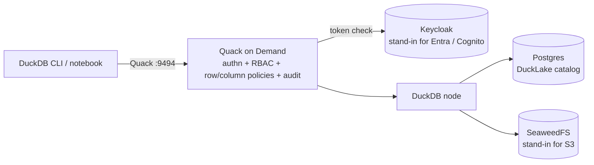

# PROTOTYPE: governed DuckLake with Quack on Demand

> Throwaway proof of concept. It answers one question:
> **can [Quack on Demand](https://github.com/starlake-ai/quack-on-demand) (QoD) give us Unity Catalog-style
> access control over DuckLake, with identity from our IdP?**



## Run

```sh
mise run demo      # wipe, start, seed tiny tables as carol, open the notebook
```

Or step by step: `mise run up`, `mise run seed`, `mise run notebook`. Admin UI: http://localhost:20900/ui (admin / admin, empty tenant); statement history at [/ui/audit/statements](http://localhost:20900/ui/audit/statements).

## The access model

All of it is in [`qod/governance.yaml`](qod/governance.yaml), imported on first boot. Users are Keycloak users ([`keycloak/realm.json`](keycloak/realm.json)); the password is checked by Keycloak and the token's `groups` claim picks the QoD role.

| User | Keycloak group | QoD role | Sees |
|---|---|---|---|
| carol | engineers | engineer | everything, can write |
| alice | analysts | analyst | both tables, `owner_email` masked to `***`, read-only |
| bob | partners | partner | only `position_reports`, only rows with `country = 'NL'`; `aircraft` is invisible |
| mallory | (none) | (none) | signs in, sees no tables |

Connect as anyone from the DuckDB 2.0 CLI (`mise run duckdb`):

```sql
ATTACH 'quack:localhost:9494' AS qod (TYPE quack, TOKEN 'tenant=demo&pool=bi&user=bob&password=bob');
SELECT country, count(*) FROM qod.main.position_reports GROUP BY ALL;   -- only NL
SELECT * FROM qod.main.aircraft;                                         -- "does not exist"
```

## Verdict

**Yes.** QoD gives table grants, row filters, column masks and filtered metadata over DuckLake, driven by IdP groups, for plain DuckDB clients. What remains unproven: Entra ID itself (token login and SCIM), and running QoD on AWS.

## Findings

- Works end to end: Keycloak sign-in, group to role mapping, table grants, row filter, column mask, metadata filtering, write denial, per-user statement history.
- Filtering on a masked column filters the masked value (`WHERE owner_email LIKE 'fleet%'` returns nothing for alice), so masks don't leak by inference.
- Copying a filtered table into a write (`INSERT ... SELECT` from a policy-protected table) is refused.
- Denial messages vary: alice's `DELETE` says she lacks the grant, her `INSERT ... VALUES` is refused as "could not be fully analysed". Both are blocked.
- Hidden tables answer "does not exist", and those attempts are logged as `ok`, not as denials. The audit trail shows the SQL but not that it was a probe.
- Users must also exist in QoD (pool grant), with a placeholder local password. In production, SCIM from Entra/Okta creates them.
- Fresh-boot quirk: a tenant database named like the bucket (`lake` in `s3://lake/...`) refused to start its pool; renamed to `flights`.
- Small inserts are inlined in the DuckLake catalog, so the seed writes no Parquet yet.

See [the governance research](docs/research/quack-governance.md) and [AWS mapping](docs/aws.md).
